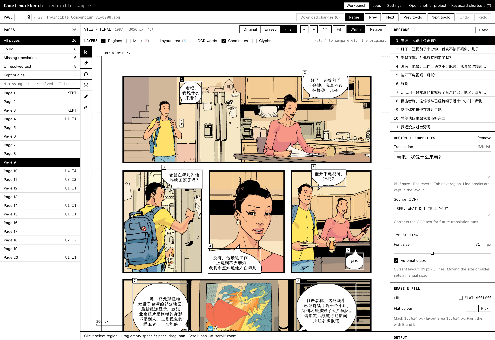
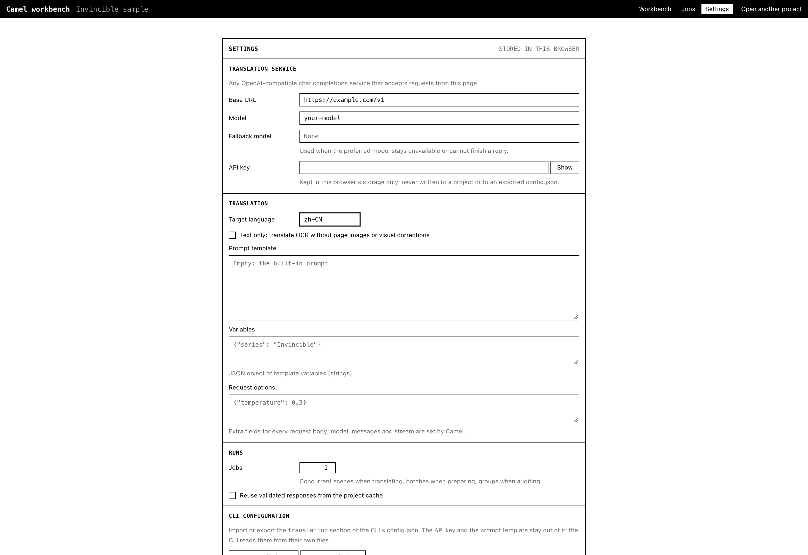
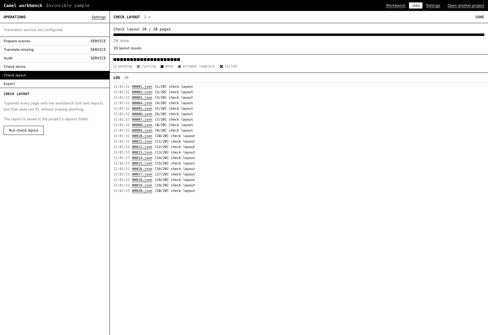

# camel

A manga translation toolkit written in Rust, with a CLI and a browser workbench. The same libraries handle OCR, balloon geometry, text removal, translation, and typesetting. The workbench runs them through WebAssembly and lets you correct the results by hand.

Image processing runs locally. Translation and review use a Chat Completions service you configure: visual mode sends page images alongside dialogue; text-only mode sends text. Fonts, recognition models, and API credentials are configured separately.

[](assets/workbench.png)

The sample shows an English comic translated into Simplified Chinese. Comic artwork is from *Invincible* and belongs to its respective rights holders. Click any screenshot to view it at full resolution.

## Quick start

Install Rust (the minimum version is declared in `Cargo.toml`) and [just](https://github.com/casey/just). Prepare the recognition models listed below and a font that covers your target language.

```sh
just install
camel analyze comic.cbz -o book --models /path/to/models
camel translate book --base-url https://example.com/v1 --model your-model
camel check-layout book -o layout.json --font /path/to/comic.ttf
camel export book -o translated.cbz --font /path/to/comic.ttf
```

Supply credentials through `CAMEL_API_KEY` or the separate key file described below. `analyze` creates a project; `translate` saves progress page by page and resumes unfinished work. Review the result in the workbench or with `review` / `apply-review` before exporting. Run `camel <command> --help` for the full command reference.

The browser workbench also needs Node.js (tested with v26), `wasm-bindgen-cli`, and Binaryen's `wasm-opt`:

```sh
rustup target add wasm32-unknown-unknown
cargo install wasm-bindgen-cli --version 0.2.129 --locked
# Install Binaryen and make wasm-opt available on PATH.
just web-dev
```

Open http://localhost:5173. The `wasm-bindgen-cli` version must match `wasm-bindgen` in `Cargo.toml`. For a production build, run `just web` and serve `web/dist/` over HTTPS; localhost also provides the secure context needed by browser storage APIs. The workbench is designed for desktop windows. Use **Pages** to collapse the page list when space is limited.

## Configuration

Common settings belong in `$XDG_CONFIG_HOME/camel/config.json`, defaulting to `~/.config/camel/config.json`. Use `--config` to choose another file. Command-line options and their environment variables take precedence; relative paths in the configuration are resolved from its directory.

```json
{
  "models": "models",
  "font": "fonts/LXGWWenKai-Medium.ttf",
  "jobs": 2,
  "translation": {
    "base_url": "https://example.com/v1",
    "model": "model-name",
    "target_language": "zh-CN",
    "prompt": "prompt.txt",
    "variables": {"series": "Series title"},
    "request_options": {}
  }
}
```

The `translation` object also accepts `fallback_model` and `api_key_file`. Keep the API key in a separate file: by default, `api-key` next to `config.json`. You can instead use `CAMEL_API_KEY` or `--api-key-file`. The service URL, model, and font also accept `CAMEL_BASE_URL`, `CAMEL_MODEL`, and `CAMEL_FONT`.

### Recognition models and fonts

Place these ONNX files in one directory:

| File | Model |
| --- | --- |
| `detector.onnx` | [comic-text-and-bubble-detector, detector-v4-s_int8](https://huggingface.co/ogkalu/comic-text-and-bubble-detector) |
| `recognizer.onnx` | [RapidOCR, en_PP-OCRv5_rec_mobile](https://github.com/RapidAI/RapidOCR/blob/main/python/rapidocr/default_models.yaml), including its embedded character dictionary |

The model directory is selected from `--models`, `CAMEL_MODELS`, or `$XDG_DATA_HOME/camel/models`, in that order. Without an XDG data directory, the default is `~/.local/share/camel/models`. Detection and English recognition run through RTen. Models are installed separately from the executable; loading errors identify the required files and directory.

Use `--font` to choose a typeface. For Chinese output, automatic discovery prefers LXGW WenKai Medium, then other installed Chinese fonts. You can place WenKai in `$XDG_DATA_HOME/camel/fonts/`, defaulting to `~/.local/share/camel/fonts/`. Fonts are loaded separately from the binary.

## Browser workbench

The workbench is a static web application. Rust code and recognition models run in Web Workers through WebAssembly; no application server is required. The CLI and workbench share the project format and pipeline, so you can use both on the same project.

**New project.** Choose a CBZ/ZIP or CBR/RAR archive, or a folder of page images; select a destination, the model directory, a font, and the worker count. Models are cached in browser storage after the first selection. The default worker count is one less than the CPU count, capped at four. An interrupted analysis skips completed pages when resumed with the same inputs.

Browser and native inference can differ slightly in floating-point results, confidence scores, coordinates, and difficult OCR. Resume an analysis in the environment that started it: switching between the CLI and browser changes the analysis build identity.

**Settings.** Configure the service URL, preferred and fallback models, target language, text-only mode, prompt template and variables, provider options, concurrency, and response caching. Import or export the CLI's `config.json`. The API key stays in this browser and is excluded from project files and exported configuration. The service must allow cross-origin browser requests. URLs must use HTTPS, except for local HTTP services on localhost or loopback addresses.

[](assets/settings.png)

**Jobs.** Run scene planning, translation, audit, terminology checks, layout checks, and export. Each job shows progress, estimated time remaining, page states, and a log. You can cancel a job and resume unfinished work later. Audit and terminology reports are saved under `reports/`; suggestions appear beside the relevant region and can be applied individually. Export to CBZ, PNG pages, or erased pages with optional masks. Keep the tab open while a job runs.

[](assets/jobs.png)

**Editing.** Open a project folder with its original comic and font. The workbench checks page contents against their recorded hashes and reports a mismatched comic. You can:

- Compare the original, erased, and final page. Overlay region numbers, erase masks, layout areas, OCR words, unresolved candidates, and glyphs. Previews use the same partial-render behavior as `camel export --allow-partial` and explain why lettering was retained.
- Edit translations, insert manual line breaks, correct OCR text, set font sizes, or keep a region or whole page in its original form.
- Paint erase masks and layout areas, choose a flat fill or sample a color, draw a new region, promote an unresolved candidate, remove a false detection, or **Dismiss** a candidate. Dismissed candidates leave the to-do count and can be restored with Undo.
- Undo and redo changes per page. Changes to source text, preservation flags, or region membership also update translation checkpoints, context, and `translation-plan.json`.

Chromium browsers such as Chrome and Edge can write directly to a chosen project directory. External changes, including those made by `camel translate`, appear within seconds. Writes check the file revision: a concurrent edit is preserved and reported instead of being overwritten. Failed writes keep undo/redo history; external changes invalidate stale history for that page.

Firefox and Safari read existing projects as snapshots. Edits stay in browser storage until you select **Download changes** and unpack the zip over the project directory. New projects in these browsers also live in browser storage; use **Download project** to save them to disk.

A WASM panic or trap ends the affected worker and displays its error. The next operation creates a new worker; the page engine also restores the selected comics and font.

## CLI workflow

### Analyze and inspect

`analyze` accepts CBR/RAR, CBZ/ZIP, PNG, JPEG, or an image directory, using natural filename order. Two page workers share model weights by default; `--jobs N` controls concurrency. Projects store source references, page hashes, regions, masks, and translations without copying the original images. Run the same command again to resume an interrupted analysis.

`camel inspect book` prints JSON summaries of completed, partial, pending, empty, preserved, issue-bearing, and content-filter-affected pages. Diagnostics go to stderr; `--quiet` suppresses progress output.

After an OCR algorithm update, `camel refresh book new-analysis -o updated-book` merges new recognition results with existing translations. It matches regions by original or corrected source text and position, preserves matching translations and context, and writes unmatched translations to `unmatched-translations.json` for review.

### Translate and resume

Translations are saved per page. Repeating the command restores terminology and context, then translates only null or blank dialogue. Existing translations remain available as same-page context.

Visual mode sends a JPEG scaled to at most 1600 pixels on its longest side, region coordinates in original image pixels, current dialogue, a preview of the next page's source text, recent dialogue, and scene summaries. Up to six labeled crops provide detail for text that becomes too small in the scaled page. When earlier source text matches after case and whitespace normalization, a few previous translations are supplied as references; the model decides whether they fit the current context. Use `--text-only` for a text model. Region IDs and terminology structures are validated before a response is saved.

Response caching is opt-in with `--cache`. Validated responses are stored under `.cache/translation/`; request bodies and API keys are excluded.

Transient network errors and HTTP 408/429/500/502/503/504 receive at most three attempts per model. Short `Retry-After` delays are honored. A delay over 30 seconds or a date-valued delay ends the run so it can be resumed later. Configure `--fallback-model`, `CAMEL_FALLBACK_MODEL`, or `translation.fallback_model` to use another model after exhausted transient retries or a length-truncated response. Each new page starts with the preferred model. Explicit content-filter refusals are recorded without switching models; authentication errors, redirects, and invalid responses are reported.

`translation_models` records the model that produced each current generated translation. Editing or clearing a translation removes that provenance entry. Invalid responses never replace page content.

Provider-specific request fields belong in `translation.request_options`. For providers that support it, an option such as `{"thinking":{"type":"disabled"}}` controls reasoning behavior. Use only options supported by your configured service.

With `--continue-on-error`, an invalid reply or region-ID mismatch is retried once; a second failure is recorded and later pages continue. Exhausted transient service failures also mark the page and continue. Three consecutive transient page failures, authentication errors, or a long server-requested delay stop the run. Explicit refusals isolate affected pages and their context. Existing translations remain usable; unfinished pages are reported and cause a nonzero exit status.

### Terminology and scene context

Pass a JSON mapping of source terms to confirmed translations with `translate --glossary terms.json`. It is saved as `glossary.json` and takes precedence over model suggestions and earlier context. Suggestions remain separate in `proposed_terms`. Conflicts with confirmed terms are recorded on the page and in the log for review.

Requests include terminology relevant to the current page, nearby pages, and preceding context. Optional entries share a 4096-character budget; confirmed terms found on the current page are always included. Updating the glossary affects future requests. Use review tools to change existing dialogue.

`camel check-terms book -o terms-review.json` checks translated dialogue against the confirmed glossary locally. It reports source terms left untranslated or missing their expected translation, with page, region, source, translation, and term details. Preserved pages and regions are excluded. Candidates still need human review: ordinary word meanings, omissions, and OCR errors can cause false positives or negatives. Findings do not prevent export or change the command's successful exit status. Existing reports are preserved.

Translation is sequential by default. Use `camel translate book --jobs 3`, or `translation.jobs`, to process independent scenes concurrently while keeping pages within a scene sequential. The first parallel run creates `translation-plan.json` from OCR text. You can prepare and inspect it in advance with `camel prepare book --jobs 3`.

Planning uses bounded text batches and merges scenes that continue across batches. Scene boundaries and summaries are model inferences. Concurrent scenes do not wait for one another's new translations, so review transitions between scenes. Each scene has independent context; conflicting proposed terms are recorded in page issues. Resuming reconstructs dialogue from completed, unaffected pages and clears context at content-filter boundaries. Changes to source text, region membership, or preservation repair the plan; translation-only edits leave it valid.

For a sequel, add `--context-from previous-book` to inherit confirmed and proposed terminology, recent reviewed dialogue, and scene summaries. Both projects must use the same target language. Once the sequel saves progress, this context is frozen as a snapshot. Later runs can omit the option. If the previous project changes, Camel reports the difference and keeps the frozen snapshot; start a new sequel project to use updated context.

### Prompts and metrics

`translate --prompt prompt.txt` replaces the translation prompt. Templates support `{{target_language}}`, `{{style}}`, `{{visual}}`, `{{response_schema}}`, `{{context}}`, and `{{terminology}}`. Context and terminology are sent only when their placeholders are present. Omitting `{{terminology}}` produces a notice and disables terminology collection for that request. Define additional string variables, such as `{{series}}`, in `translation.variables`; values are inserted literally without recursive expansion.

`{{style}}` enables the associated local dialogue formatting rules. Without it, model punctuation is retained. Current dialogue, coordinates, and selected context are sent as a separate user message. Checkpoints retain the prompt fingerprint as provenance.

For example, this template includes context but omits terminology:

```text
Translate the comic dialogue into natural {{target_language}}.
Preserve tone and meaning; keep uncertain names in their original form for review.
{{visual}}
{{context}}
{{style}}
{{response_schema}}
```

The Simplified Chinese style omits ordinary sentence-ending periods at balloon boundaries, preserves meaningful punctuation, pauses, interruptions, repetition, emphasis, profanity, and character voice, and avoids inventing ellipses between consecutive balloons. It follows the tone and continuity principles of the [Netflix Simplified Chinese timed-text style guide](https://studiopartner.netflix.net/studio/chinese-simplified-timed-text-style-guide), without adopting subtitle length, line, duration, space-for-punctuation, or repetition-removal rules. Local normalization applies to newly generated dialogue; quoted punctuation, repeated punctuation, and manually reviewed text are preserved.

`translation-metrics.jsonl` records request duration, actual model, attempt count, cache hits, token usage, and errors. It excludes request content, images, and credentials. `elapsed_ms` covers one API attempt, excluding page preparation and saving; it does not separate service queuing from generation.

### Review and repair

`camel review book -o review.json` exports editable dialogue with page names, image dimensions, region IDs, OCR text, text and balloon bounds, and `translation`. Where analysis is available, it includes panel IDs, corrected source text, speakers, and scene summaries. Those context fields are read-only references, and model inferences retain provenance. Each page also lists unresolved OCR candidates with their bounds and reasons.

After editing the file, run `camel apply-review book review.json`. Camel checks source text, region IDs, and `original_translation` before applying changes. If both the project and review file changed the same translation differently, it reports a conflict. Unchanged review entries preserve newer project translations. Images, masks, and geometry are retained. Run `export` again to typeset the updated dialogue; subsequent translation runs use the reviewed text as context.

Set `"preserve_original": true` on a page or region to keep covers, credits, or other material unchanged. Translation skips it, and export preserves its original lettering. Set the flag to `false` to resume processing. A region's `font_size` can select a size from 10 to 64 pixels; `null` restores automatic sizing.

For model-assisted review, run `camel audit book -o audit.json`, optionally with `--jobs 3` and the translation's `--prompt`. Audit groups contain up to four pages within a scene, with neighboring source context. Without a plan, adjacent pages are grouped together. Evidence-based suggestions are stored in `audit_issues`; current dialogue in `pages[].regions[].translation` stays unchanged. Copy accepted suggestions into the translation fields, then apply the file with `apply-review`.

Validated audit responses can be reused after a failed run. Content-filter refusals are recorded, and later groups that may contain the same material are skipped. Repeat `--skip-page` to exclude specific pages. After two invalid replies, audit continues with other groups, writes a partial report, and exits with an error. Retry failed groups with a new output path. Oversized audit requests are rejected rather than silently truncating dialogue.

`camel repair-region book request.json` rebuilds a reviewed unresolved region and supplies a translation. Requests contain `page`, the recorded `source`, `region`, `original_text`, `exclude_words`, `translation`, and optional `insert_before` / `insert_after` reading-order anchors. When splitting neighboring dialogue, `split` includes the previous and replacement source and translation. The command validates images and masks, preserves raw OCR, updates checkpoints, and invalidates affected scene summaries.

`camel remove-region book request.json` removes a confirmed false detection. Its request contains `page`, `source`, `region`, and `original_text`. Related context, checkpoints, and the translation plan are updated, while original OCR evidence remains available.

### Check layout and export

`camel check-layout book -o layout.json --font comic.ttf` uses the same font, phrase hints, source letter heights, and balloon geometry as export. It reports selected sizes, text that does not fit, missing glyphs or translations, and overlaps. Pages with content-filter history still have their available translations checked. Source-image errors fail the command. Reports preserve existing files. Review the final rendered images as well as the report.

`camel export book -o translated.cbz` erases source lettering and typesets translations. Use a directory output for individual PNGs, or a `.cbz` path for an archive. `--clean` exports erased pages without typesetting; directory output includes matching JSON metadata. With directory output, `--mask-output` also writes masks whose white pixels identify erased areas. Clean export needs analysis results but no translations. Output dimensions match the original images. Repeated exports reuse identical files, complete missing ones, and report conflicting existing content.

Dialogue identical to its source retains the original lettering. Recognized text without a usable glyph mask is also preserved and reported. `--allow-partial` exports unfinished projects: missing or unrenderable dialogue stays original, as do neighboring regions whose erase or layout areas overlap retained text. Other layout failures preserve the whole page. Content-filter history is reported while available translations render normally.

Warnings and retention reasons are recorded in `render-report.json` for a directory, or `<comic>.report.json` beside a CBZ. Override the path with `--report`.

## Project format and image processing

`index.json` lists page records, `source.json` points to the original comic, and `NNNNN.json` stores regions, masks, translations, analysis evidence, and checkpoints. `translation-plan.json` stores scene grouping, `glossary.json` stores confirmed terminology, and `reports/` holds workbench reports. Original images and models remain separate.

Page `issues` are objects tagged by `kind`: `unresolved_text`, `translation_failed`, `content_filter`, `content_filter_context`, `confirmed_term_conflict`, `scene_term_conflicts`, or a manual `note`. `inspect` exposes these structures; the workbench and export reports display readable messages. Page `context` contains glossary state, proposed terms, and scene summaries. Recent dialogue is reconstructed from page records.

The project is in active development and its format can change directly. Records with the former string-based issues need a one-time external conversion; the application does not include a legacy reader.

### Coordinates, masks, and evidence

Coordinates use original image pixels with a top-left origin. Rectangle right and bottom edges are exclusive. `page.regions` contains source text, word coordinates and confidence, translations, and background colors. `bubble.glyphs` records source glyphs, `bubble.erase` the erase area, and `bubble.interior` the estimated safe typesetting area. Gradient reconstruction is stored in `background_model` or `background_repair`.

Horizontal mask spans are `[y, start, end]`, with exclusive `end`. Dense glyph masks use coordinate deltas, ZigZag and variable-length integer encoding, then zlib and Base64; empty glyph masks are omitted. Local background repair is identified by `background_repair.method = "harmonic_local_v1"`.

`analysis` preserves ordered panels, dialogue-to-panel associations, original OCR, and closed contours of safe typesetting areas, including holes or disconnected parts. These contours describe usable layout space, not exact balloon outlines. Unresolved regions retain words, confidence, and reasons. Corrected source text, speaker descriptions, and scene summaries are stored separately with provenance.

Detection results live in `analysis.visual_detections`; `analysis.ocr_engine` identifies the recognizer. `analysis.initial_ocr` preserves raw observations. Alternative whole-region recognition is stored in `analysis.ocr_alternatives` and is not used automatically without supporting evidence.

`analysis.ocr_observations` connects `detection_id`, line bounds, and reading-ordered `initial_ocr` block IDs. Detected but unread lines retain coordinates; each word's `line` points to the corresponding line index. Observations remain traceable after deduplication. Three separate aligned dots can be recognized geometrically as an ellipsis; their line indices are stored in `geometric_lines`, with zero confidence to indicate the absence of a model score.

### Recognition and rendering

The detector distinguishes balloons, text inside balloons, and lettering in artwork. Recognition groups connected strokes into lines, uses neighboring letter heights to recover missed lines, and excludes decorative strokes while retaining original coordinates for erasure. Contrast-aware grayscale conversion helps with colored lettering. Connected paper and stroke structure distinguish small text and punctuation from surrounding artwork and caption borders. CTC word boundaries are aligned with image spacing; drop capitals are associated with their baseline and mapped back to original coordinates.

Repeated observations and truncated duplicate readings are deduplicated while retaining raw OCR evidence. Regions share panel ordering and paper detection, and overlapping text boxes are divided by word positions.

Background estimation uses color samples, connected regions, and narrow-neck separation to constrain balloons that connect to gutters. Physical paper areas and dialogue-specific layout areas are treated separately. Flat backgrounds use a representative paper color; validated gradient models reconstruct continuous backgrounds. Narrow local interpolation can repair lettering without a complete paper boundary while avoiding nearby unrecognized strokes. Text without a safe region remains visible in the original image and is recorded for review.

Horizontal Chinese typesetting uses the available interval on each scanline, source letter height, consistent page typography, and balanced margins. Line breaks account for width, punctuation, isolated characters, glyph overhang, and pauses. Jieba segmentation and confirmed terminology guide breaks; a term may still break when space requires it. The bundled dictionary comes from jieba-rs 0.11; its license is in `crates/camel/src/data/`. A page is erased and drawn only after layout succeeds.

## Libraries

All workspace crates live under `crates/`:

| Crate | Responsibility |
| --- | --- |
| `camel` | Geometry, editable masks, translation contracts, comic readers, and typesetting. `geometry::analyze` turns supplied `TextBlock` values into a `Page`; `translation::translate_page` and `translate_missing_page` accept a replaceable `Translator`; `layout::Typesetter` measures and renders text. |
| `camel-vision` | A shareable recognition `Engine`, detector, and line recognizer. `Engine::analyze` returns a `Page` and `AnalysisMetadata` from an RGB image. |
| `camel-project` | Project storage and orchestration: analysis, planning, translation, audit, checks, export, editing, and plan repair. File access, requests, timing, and progress are supplied through `host::Host`. |
| `camel-web` | WebAssembly bindings and the browser implementation of `Host`. |
| `camel-cli` | Command-line interface with local filesystem access and ureq-backed requests. |

```rust,no_run
use camel_vision::Engine;
use std::path::Path;

let engine = Engine::load(Path::new("models"), 2)?;
let image = image::open("page.jpg")?.to_rgb8();
let (page, analysis) = engine.analyze(&image)?;
# Ok::<(), Box<dyn std::error::Error>>(())
```

`comic::ComicSource` reads individual pages from directories, CBZ/ZIP, and CBR/RAR, through paths or seekable readers. `geometry::prepare_erase(&original, &bubble)?.layer()` produces a transparent RGBA erase layer with its page coordinates. Compositing it over the original matches direct erasure; layers are generated on demand from the image, masks, and reconstruction parameters.

## Development

```sh
just check
just build
just dist
just web
```

`just check` runs formatting, native and wasm32 Clippy, Rust tests, and documentation checks. `just web` builds WebAssembly, bundles the frontend, type-checks application and test code, and runs frontend tests.

Tests requiring fonts, models, or sample pages are ignored by default. Follow each test's environment requirements. For example:

```sh
CAMEL_TEST_FONT=/path/to/comic.ttf \
  cargo test -p camel-cli --test workflow --test review -- --ignored
```

Validated toolchain: Rust 1.98.1, Node.js 26.13.1, wasm-bindgen 0.2.129, and wasm-opt 133.

For recognition and erasure evaluation against local images:

```sh
just evaluate models/ pages/ results/ 2
```

The final argument controls page concurrency and defaults to two. Models are loaded once and reused; erased images are checked in memory. Per-page results contain the source path, structured output, and timing, with aggregate status in `summary.json`. Source images and models remain outside the results directory.

The `release` profile uses thin LTO. `dist` uses fat LTO, one codegen unit, and stripped symbols; image processing retains optimization level 3. Image codecs are limited to PNG and JPEG. Typesetting uses ab_glyph and networking uses ureq.

## References

The pipeline and layout draw on [Koharu](https://github.com/koharu-rs/koharu), mask layering on [BallonsTranslator](https://github.com/dmMaze/BallonsTranslator), balloon separation on [MomoTranslator](https://github.com/alicewish/MomoTranslator), and text connectivity and mask refinement on [manga-image-translator](https://github.com/zyddnys/manga-image-translator). Rust style follows the [Microsoft](https://microsoft.github.io/rust-guidelines/) and [Google](https://google.github.io/styleguide/rustguide.html) guides; CLI behavior follows [clig.dev](https://clig.dev/).
